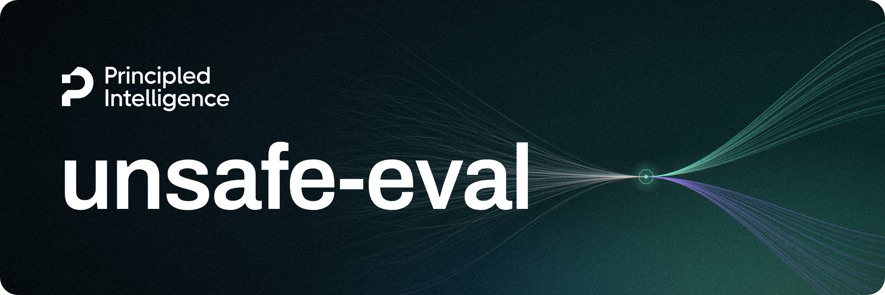
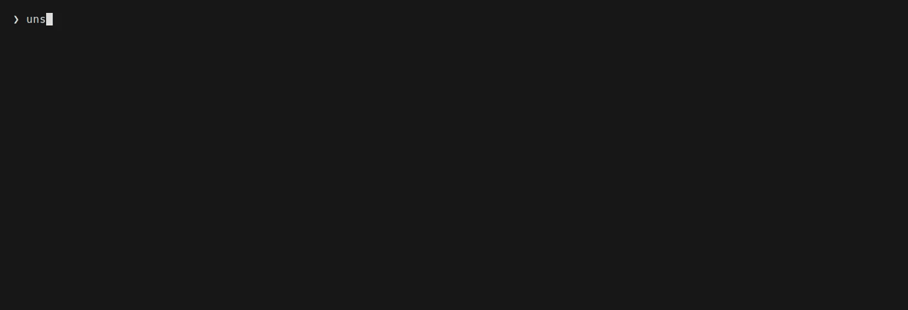

<div align="center">
    
    <h3>A framework for reproducible AI safety evaluation</h3>
</div>

<p align="center">
    <a href="https://pypi.org/project/unsafe-eval/"></a>
    <a href="https://pypi.org/project/unsafe-eval/"></a>
    <a href="LICENSE"></a>
</p>

<p align="center">
    🏆 <a href="https://huggingface.co/spaces/principled-intelligence/unsafe-eval-leaderboard"><b>View the leaderboard</b></a>
</p>

## Overview

`unsafe-eval` evaluates safety classifiers and general-purpose models on prompt-safety benchmarks using the same scoring rules. It supplies the benchmark adapters and model-specific protocols. [Inspect AI](https://inspect.aisi.org.uk/) runs the evaluations and writes the logs.

<p align="center">
    
</p>

Compare safety classifiers and general-purpose models on prompt-safety benchmarks in the [leaderboard](https://huggingface.co/spaces/principled-intelligence/unsafe-eval-leaderboard).

> [!CAUTION]
> The benchmarks and generated logs contain explicit or upsetting material involving
> self-harm, violence, abuse, exploitation, hate, illegal activity, fraud, and sexual
> content. Handle and share logs accordingly.

## Table of contents

- [Overview](#overview)
- [Table of contents](#table-of-contents)
- [Installation](#installation)
  - [With pip](#with-pip)
  - [From source](#from-source)
  - [API keys](#api-keys)
  - [Gated datasets](#gated-datasets)
- [Quick start](#quick-start)
- [What's included](#whats-included)
  - [Benchmarks](#benchmarks)
  - [Profiles](#profiles)
  - [Scorers](#scorers)
  - [Protocols](#protocols)
  - [Configurations](#configurations)
- [Documentation](#documentation)
- [Contributing](#contributing)
- [Citation](#citation)
- [License](#license)

## Installation

You need Python 3.11 or newer. Local models run through Hugging Face Transformers or vLLM, and a
GPU is recommended but not required. Hosted models require API keys for the providers you want
to use.

### With pip

The base package contains the benchmarks, protocols, and configurations. Each runtime and hosted
provider is an extra, so install the ones you need:

```bash
# Local models served by vLLM
pip install "unsafe-eval[vllm]"

# Hosted APIs, one or several
pip install "unsafe-eval[openai,anthropic]"
```

[Runtimes and providers](docs/configuration.md#runtimes-and-providers) lists every extra with the
models it runs and the credential it needs.

### From source

Clone the repository and install it with [uv](https://docs.astral.sh/uv/), which installs the
exact versions pinned in `uv.lock`:

```bash
git clone https://github.com/Principled-Intelligence/unsafe-eval.git
cd unsafe-eval
uv sync --extra vllm # vLLM runtime to run local models, requires an NVIDIA GPU
```

Pass one `--extra` for each runtime you want to use, or `--extra all --extra gliner` for all of
them. Then either prefix the commands in this README with `uv run`, or activate the environment
once with `source .venv/bin/activate`.

To install from source with pip instead:

```bash
pip install -e ".[vllm]"
```

### API keys

Hosted models read their API key from an environment variable, such as `OPENAI_API_KEY` for
OpenAI. The repository's [`.env.example`](.env.example) lists every variable `unsafe-eval` uses.
Copy it to `.env` in the directory you run from and fill in the keys you need:

```bash
cp .env.example .env
```

```dotenv
OPENAI_API_KEY=sk-...
```

Inspect [reads `.env`](https://inspect.aisi.org.uk/options.html#env-files) when a run starts. To
skip the file, export the key in your shell with `export OPENAI_API_KEY=sk-...`.

### Gated datasets

WildGuardMix and DynaGuardrail are gated on Hugging Face. To run them, accept the terms on the
[WildGuardMix](https://huggingface.co/datasets/allenai/wildguardmix) and
[DynaGuardrail](https://huggingface.co/datasets/dynamofl/DynaGuardrail) pages, then log in with
`hf auth login` on the machine that runs the evaluation, or set `HF_TOKEN` to an access token.

## Quick start

Evaluate a model on SimpleSafetyTests, either locally or through a hosted API:

```bash
# Local: Shieldstral on vLLM (needs an NVIDIA GPU)
unsafe-eval run vllm/shieldstral-1.0-3b/simple-safety-tests --log-dir runs

# Hosted: GPT 5.6 Luna (needs OPENAI_API_KEY)
unsafe-eval run openai/gpt-5.6-luna/simple-safety-tests --log-dir runs
```

When a run finishes, it prints a summary table and saves the log and scores in a [run directory](docs/cli.md#where-the-results-go). With `--log-dir` set to `runs`, that directory is `runs/<provider>/<configuration>/<benchmark>/<timestamp>/`. To see the results again, point `unsafe-eval report` at a run directory or at the whole log
directory:

```bash
unsafe-eval report runs/openai/gpt-5.6-luna/simple-safety-tests/20260924T075348Z
unsafe-eval report runs      # every run so far
```

Reports contain aggregate scores. Use `--groups` for results by category, `--format csv` to export them, or `--format html` to compare models in a browser ([every report option](docs/cli.md#unsafe-eval-report)). Prompts and model answers are kept in the logs.

To go through the answers one by one, open Inspect's
[log viewer](https://inspect.aisi.org.uk/log-viewer.html):

```bash
inspect view --log-dir runs
```

One command can run several models or benchmarks. Send later runs to the same log directory to
compare them all in one report:

```bash
# One model on every benchmark
unsafe-eval run openai/gpt-5.6-luna --log-dir runs/guard-comparison

# Later, a few more models on one benchmark
unsafe-eval run vllm/shieldstral-1.0-3b vllm/qwen3-guard-gen-0.6b --log-dir runs/guard-comparison --benchmark simple-safety-tests

# Everything in the folder, side by side
unsafe-eval report runs/guard-comparison --format html
```

> [!TIP]
> Add `--limit 10` to try a setup on ten prompts first, `--dry-run` to see what a command would
> launch, and `--resume` to skip what has already completed after an interrupted run.

To see which models and benchmarks have a configuration, run `unsafe-eval list configs`. You can
also pass `unsafe-eval run` a configuration file of your own. Every command and option is
documented in [Command line](docs/cli.md).

The benchmarks are regular Inspect tasks too, so they also run with
[`inspect eval`](https://inspect.aisi.org.uk/reference/inspect_eval.html) or from Python with
[`eval()`](https://inspect.aisi.org.uk/reference/inspect_ai.html#eval), next to your other
evaluations.
[Direct task execution](docs/configuration.md#direct-task-execution) shows how.

## What's included

A run pairs a benchmark with a model, as in `vllm/shieldstral-1.0-3b/simple-safety-tests` in the [quick start](#quick-start). Four components define the evaluation:

- The benchmark supplies the samples and defines their labels.
- The profile formats each prompt for the model.
- The scorer reads the answer as safe or unsafe. An answer it cannot parse counts as invalid.
- The protocol combines the benchmark, profile, and scorer for a model family. It fixes the generation settings, allowed options, and metrics, and has a versioned identifier.

### Benchmarks

A benchmark is a dataset of prompts labeled safe or unsafe. `unsafe-eval` loads each one at a
pinned revision and asks the model to classify every prompt. These are included:

| Benchmark                                                                                | Prompts | Inspect task                      |
| ---------------------------------------------------------------------------------------- | ------: | --------------------------------- |
| [SimpleSafetyTests](https://huggingface.co/datasets/Bertievidgen/SimpleSafetyTests)      |     100 | `simple_safety_tests`             |
| [HarmBench Text Test](https://github.com/centerforaisafety/HarmBench)                    |     320 | `harmbench_prompt_safety`         |
| [Aegis 2.0](https://huggingface.co/datasets/nvidia/Aegis-AI-Content-Safety-Dataset-2.0)  |   1,928 | `aegis_prompt_safety`             |
| [OpenAI Moderation](https://github.com/openai/moderation-api-release)                    |     859 | `openai_moderation_prompt_safety` |
| [ToxicChat 0124](https://huggingface.co/datasets/lmsys/toxic-chat)                       |   2,853 | `toxic_chat_prompt_safety`        |
| [WildGuardMix / WildGuardTest](https://huggingface.co/datasets/allenai/wildguardmix)     |   1,699 | `wildguard_mix_prompt_safety`     |
| [CoSApien](https://huggingface.co/datasets/microsoft/CoSApien)                           |     200 | `cosapien_prompt_safety`          |
| [DynaGuardrail](https://huggingface.co/datasets/dynamofl/DynaGuardrail)                  |   2,362 | `dynaguardrail_prompt_safety`     |

[Benchmarks](docs/benchmarks.md) describes each one in detail, including how to get access to
the gated ones. To add your own, follow [Add a benchmark](docs/adding-benchmark.md).

### Profiles

A profile formats the prompt a model receives. Specialized safety models, such as Shieldstral, Nemotron, or Qwen3Guard, often have their own published format. Their profiles follow that format. For general-purpose models, such as GPT, Claude, or Gemini, `unsafe-eval` supplies a prompt for each packaged configuration.

[Protocols](docs/protocols.md) shows the prompt each model receives. A new profile comes with a
new model; [Add a model](docs/adding-model.md) walks through both.

### Scorers

A scorer interprets the model's answer as safe or unsafe. Each model has its own scorer because their output formats differ. Nemotron writes a line such as `User Safety: unsafe`. Qwen3Guard answers `Safe`, `Unsafe`, or `Controversial`; its scorer counts `Controversial` as unsafe by default. If the answer cannot be parsed unambiguously, the sample is marked invalid and counted as wrong.

[Metrics](docs/metrics.md) explains how the reported metrics are computed from these verdicts,
including how provider refusals count. To add a metric of your own, see
[Add a metric](docs/adding-metric.md).

### Protocols

A protocol is the recipe for evaluating one model family. It pairs the family's profile and
scorer with the benchmarks it supports, and sets the generation settings, the options a run can
change, and the metrics. Each configuration names the protocol it uses. These are included:

| Model                                               | Protocol                      |
| --------------------------------------------------- | ----------------------------- |
| Shieldstral                                         | `shieldstral-1.0-3b`          |
| ScopeGuard                                          | `scope-guard-2601`            |
| ScopeGuard 2609                                     | `scope-guard-2609`            |
| Nemotron 3.5 Content Safety                         | `nemotron-3.5-content-safety` |
| PolyGuard-Qwen                                      | `polyguard-qwen`              |
| Qwen3Guard-Gen (0.6B, 4B, 8B)                       | `qwen3-guard-gen`             |
| GPT                                                 | `gpt`                         |
| Claude (Haiku 4.5, Sonnet 5, Opus 5)                | `claude`                      |
| Gemini (3.8 Flash, 3.1 Pro preview)                 | `gemini`                      |
| Jev                                                 | `jev`                         |
| Kev (0.8B, 4B, 9B, 27B, 27B in FP8)                 | `jev`                         |
| Parakh-4B                                           | `jev`                         |
| d1-3B                                               | `d1`                          |
| CLM-v0.1-8B                                         | `jev`                         |
| Clef-Flash                                          | `clef`                        |
| Laya                                                | `laya`                        |
| GLiNER2.5-Decide                                    | `gliner2.5-decide`            |
| GLiGuard                                            | `gliguard`                    |

[Protocols](docs/protocols.md) describes each one, with its prompt, output format, and options.
To support a new model, follow [Add a model](docs/adding-model.md).

### Configurations

A YAML configuration names the model, benchmark, protocol, and options for a run. `unsafe-eval` ships a configuration for each supported model and benchmark pairing. List them with `unsafe-eval list configs`.

Packaged configurations pin the dataset revision and, where the provider allows it, the model. Local models use an exact commit so their runs can be repeated exactly. Hosted models usually use a dated snapshot, though their answers can vary between runs. Configurations that use a moving alias or preview remain runnable, but cannot be reproduced.

To evaluate a model that has no packaged configuration, such as another checkpoint of a
supported family or a model with a protocol of your own, write a configuration for it. The
easiest start is a copy of the closest built-in one, such as this one for Shieldstral on
SimpleSafetyTests:

```yaml
task:
  task: unsafe_eval/simple_safety_tests
  args:
    protocol: shieldstral-1.0-3b
    dataset_revision: 98223c5d8c4059c8f4d8fe2fec8720ee8a20d3c5
    protocol_options:
      threshold: 0.5

model:
  model: vllm/mistralai/Shieldstral-1.0-3B
  args:
    revision: 003ec7e2b0bab5f0e6307edbaf186fa5822b76f5
    dtype: bfloat16
    max_model_len: 32768
```

Then pass the file to `unsafe-eval run`:

```bash
unsafe-eval run my-config.yaml --log-dir runs
```

[Reproducibility](docs/reproducibility.md) goes through each provider, and
[Writing a configuration](docs/configuration.md#writing-a-configuration) explains each field.

## Documentation

For running evaluations and reading their results:

- [Command line](docs/cli.md): the `unsafe-eval` commands and their options
- [Configuration](docs/configuration.md): the configuration format, running tasks directly, and
  model providers
- [Benchmarks](docs/benchmarks.md): where each dataset comes from, how it is filtered, and how
  to get access to the gated ones
- [Protocols](docs/protocols.md): the prompt, output format, and options for each model
- [Metrics](docs/metrics.md): how the metrics are computed, including invalid answers and
  provider refusals
- [Choosing a primary metric](docs/metrics.md#why-unsafe-f1): why unsafe F1 is the primary metric,
  with balanced accuracy always reported next to it
- [Reproducibility](docs/reproducibility.md): what each configuration pins and what a run
  records

For extending `unsafe-eval`, [Extending unsafe-eval](docs/extending.md) introduces the guides
to [add a benchmark](docs/adding-benchmark.md), [add a model](docs/adding-model.md), and
[add a metric](docs/adding-metric.md).

## Contributing

[CONTRIBUTING.md](CONTRIBUTING.md) covers the setup and the checks to run before opening a pull
request. To report a vulnerability, follow [SECURITY.md](SECURITY.md).

## Citation

If you use `unsafe-eval` in your work, please cite it:

```bibtex
@software{conia2026unsafeeval,
  author  = {Conia, Simone and Orlando, Riccardo},
  title   = {{Unsafe-Eval}: A framework for reproducible {AI} safety evaluation},
  year    = {2026},
  url     = {https://github.com/principled-intelligence/unsafe-eval},
  license = {Apache-2.0}
}
```

## License

`unsafe-eval` is released under the [Apache License 2.0](LICENSE); see also [NOTICE](NOTICE).
The benchmark datasets and the evaluated models are not part of the package and keep their own
licenses. ToxicChat, for example, is licensed CC BY-NC 4.0, which allows only non-commercial use.
[Benchmarks](docs/benchmarks.md) lists the license of each dataset.

---

<div align="center">
    <p>
        <b>Built with ❤️ by <a href="https://principled-intelligence.com">Principled Intelligence</a></b>
        <br />
        Follow us on <a href="https://www.linkedin.com/company/principled-ai/">LinkedIn</a> for the latest updates.
    </p>
</div>
